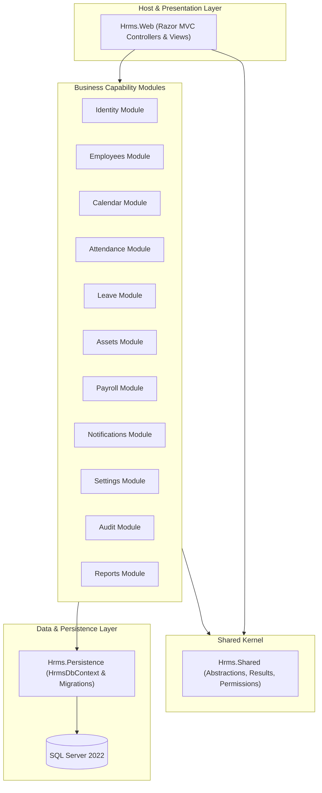

# HRMS V1 - Enterprise Human Resource Management System

[](https://dotnet.microsoft.com/)
[](https://martinfowler.com/bliki/MonolithFirst.html)
[](https://www.microsoft.com/sql-server/)
[](https://learn.microsoft.com/ef/core/)
[](https://getbootstrap.com/)
[](tests/)

A robust, enterprise-grade Human Resource Management System designed for single-company operations. Built with a **clean Modular Monolithic Architecture**, CQRS patterns, permission-based authorization, and modern ASP.NET Core MVC with responsive dashboard analytics.

---

## 📑 Table of Contents

- [🌟 System Overview](#-system-overview)
- [🏛️ Architectural Design](#️-architectural-design)
  - [Modular Monolith Principles](#modular-monolith-principles)
  - [Module Dependency Flow](#module-dependency-flow)
  - [CQRS & Repository Pattern](#cqrs--repository-pattern)
- [🧩 Core Modules & Features](#-core-modules--features)
  - [1. Identity & Role-Based Access Control (RBAC)](#1-identity--role-based-access-control-rbac)
  - [2. Employee & Organization Management](#2-employee--organization-management)
  - [3. Calendar, Shifts & Working Days](#3-calendar-shifts--working-days)
  - [4. Smart Attendance & Live Clocking](#4-smart-attendance--live-clocking)
  - [5. Leave Management & Approval Workflows](#5-leave-management--approval-workflows)
  - [6. Asset Inventory & Tracking](#6-asset-inventory--tracking)
  - [7. Payroll & Compensation](#7-payroll--compensation)
  - [8. Real-time Notifications Center](#8-real-time-notifications-center)
  - [9. Company Settings & Branding](#9-company-settings--branding)
  - [10. Audit Logging & Compliance](#10-audit-logging--compliance)
  - [11. Reports & Excel Export](#11-reports--excel-export)
- [👥 User Roles & Access Matrix](#-user-roles--access-matrix)
- [🗄️ Database Design & Source of Truth](#️-database-design--source-of-truth)
- [📂 Project Directory Layout](#-project-directory-layout)
- [🚀 Quick Start & Installation](#-quick-start--installation)
  - [Prerequisites](#prerequisites)
  - [Configuration Setup](#configuration-setup)
  - [Database Migration & Seeding](#database-migration--seeding)
  - [Run the Application](#run-the-application)
- [🔑 Default System Accounts](#-default-system-accounts)
- [🧪 Testing & Quality Assurance](#-testing--quality-assurance)
- [📖 Documentation & References](#-documentation--references)

---

## 🌟 System Overview

HRMS V1 delivers a cohesive administrative portal and employee self-service platform:
- **Administrative & HR Operations:** Complete lifecycle management from employee onboarding, departmental assignments, flexible shift scheduling, daily attendance sheets, leave quota distribution, asset assignment, to payroll processing.
- **Employee Self-Service (ESS):** Personalized dashboard featuring live Asia/Dhaka clock, one-click attendance check-in/out, break management, regularization requests, leave balance lookup, asset tracking, and profile photo customization.
- **Security & Multi-Factor Guardrails:** National ID encryption (`NidNumberEncrypted`), strict session expiration, anti-tampering RowVersion concurrency checks, and complete audit trail for compliance.

---

## 🏛️ Architectural Design



### Modular Monolith Principles
1. **Single Deployable Unit:** Eliminates microservices orchestration, latency, and distributed transaction complexity while preserving strict modular encapsulation.
2. **Contract-Driven Cross-Module Communication:** Modules never reference another module's internal domain or database context. Communication occurs strictly via tiny public contract interfaces (`Hrms.<Module>.Contracts`).
3. **No Cross-Module Navigation Properties:** Database foreign keys exist at the schema level, but domain entities store only primitive foreign keys (e.g., `Guid EmployeeId`).
4. **Independent Modules:** Each module encapsulates its own domain entities, business logic, validation rules, application commands, and queries.

### Module Dependency Flow
Circular dependencies are prohibited. The dependency graph strictly respects:
```
Reports -> Payroll -> Attendance -> Leave -> Calendar -> Employees -> Settings / Audit / Identity
```

### CQRS & Repository Pattern
- **Write Operations (Commands):** Encapsulate state changes through application command handlers, transactional boundaries, validation pipelines (`FluentValidation`), and domain repositories.
- **Read Operations (Queries):** High-performance read queries bypass repository overhead and project directly from `HrmsDbContext` with `.AsNoTracking()` into optimized DTO models.

---

## 🧩 Core Modules & Features

<details open>
<summary><b>1. Identity & Role-Based Access Control (RBAC)</b> (Click to collapse/expand)</summary>

- **Path:** [`src/Modules/Identity/`](src/Modules/Identity/)
- **Contracts:** [`src/Modules/Identity/Hrms.Identity.Contracts/`](src/Modules/Identity/Hrms.Identity.Contracts/)
- **Capabilities:**
  - ASP.NET Core Identity with `Guid` primary keys and secure cookie authentication.
  - Granular permission-based authorization policies (e.g., `[Authorize(Policy = Permissions.Attendance.Manage)]`).
  - Three system roles: **Admin**, **HR**, and **Employee** (protected from deletion/renaming).
  - Dynamic permission toggles per role managed via the Admin UI.
  - Security stamp regeneration upon deactivation ensuring active cookies immediately terminate.
  - Lockout protection after 5 failed login attempts.
</details>

<details open>
<summary><b>2. Employee & Organization Management</b> (Click to collapse/expand)</summary>

- **Path:** [`src/Modules/Employees/`](src/Modules/Employees/)
- **Contracts:** [`src/Modules/Employees/Hrms.Employees.Contracts/`](src/Modules/Employees/Hrms.Employees.Contracts/)
- **Capabilities:**
  - **Organizational Structure:** Multi-tier organization model: `Departments` -> `Designations` -> `Grades` (with Base Salary) -> `Employees`.
  - **Composite Foreign Key Integrity:** Composite keys prevent assigning designations outside the parent department or grades outside the designation.
  - **Data Privacy & Encryption:** Employee National ID is encrypted in the database (`NidNumberEncrypted`) and only accessible to users with the `employees.view_nid` permission.
  - **Profile Photo Management:** Integrated file upload handler with automatic path resolution, thumbnail caching, and initials fallback badge in topbar and sidebar.
  - **Lifecycle States:** `Active`, `OnNotice`, `Resigned`, `Terminated`.
</details>

<details open>
<summary><b>3. Calendar, Shifts & Working Days</b> (Click to collapse/expand)</summary>

- **Path:** [`src/Modules/Calendar/`](src/Modules/Calendar/)
- **Contracts:** [`src/Modules/Calendar/Hrms.Calendar.Contracts/`](src/Modules/Calendar/Hrms.Calendar.Contracts/)
- **Capabilities:**
  - **Company Working Days:** 7-day configuration (Sunday to Saturday) with standard weekly off-days (Friday & Saturday pre-seeded).
  - **Shift Versioning:** `ShiftVersions` track `StartTime`, `EndTime`, `GraceMinutes`, and `BreakMinutes`. Modifying shift parameters generates a new version while closing the old one, guaranteeing historical attendance integrity.
  - **Night Shift Support:** Automatically handles cross-midnight schedules (`EndTime < StartTime`).
  - **Holiday Management:** Government and Company holidays with conflict resolution against weekly off-days.
</details>

<details open>
<summary><b>4. Smart Attendance & Live Clocking</b> (Click to collapse/expand)</summary>

- **Path:** [`src/Modules/Attendance/`](src/Modules/Attendance/)
- **Contracts:** [`src/Modules/Attendance/Hrms.Attendance.Contracts/`](src/Modules/Attendance/Hrms.Attendance.Contracts/)
- **Capabilities:**
  - **Employee Self-Service Clocking:** Live Asia/Dhaka clock widget with 1-click `Check-In`, `Check-Out`, and `Start/End Break` buttons.
  - **Grace Period & Punctuality:** 15-minute grace window past shift start before marking an employee as `Late`.
  - **Overtime Calculation:** Automatically computes overtime hours for working time exceeding the 8-hour daily quota.
  - **Attendance Regularization:** Employees who missed clocking in can submit an attendance request with justification for Admin/HR review and approval.
  - **HR Daily Sheet:** Comprehensive daily table with automated pre-fills (holidays, weekends, approved leave), bulk-entry options, and note requirements for manual edits.
  - **Deterministic Status Calculation:** Evaluated in strict order:
    1. *Holiday / Weekend*
    2. *OnLeave*
    3. *Absent* (No check-in)
    4. *HalfDay* (Worked hours < threshold)
    5. *Late* (Check-in > Shift Start + Grace)
    6. *Present*
</details>

<details open>
<summary><b>5. Leave Management & Approval Workflows</b> (Click to collapse/expand)</summary>

- **Path:** [`src/Modules/Leave/`](src/Modules/Leave/)
- **Contracts:** [`src/Modules/Leave/Hrms.Leave.Contracts/`](src/Modules/Leave/Hrms.Leave.Contracts/)
- **Capabilities:**
  - **Leave Types:** Paid and unpaid leave categories with yearly entitlement quotas and optional document attachment requirements.
  - **Leave Quota Distribution:** Automated yearly balance generator for active employees.
  - **Smart Date Range Calculation:** Automatically excludes weekly off-days and public holidays from requested leave durations.
  - **Half-Day Leave:** Dedicated support for 0.5 day leave requests.
  - **Two-Phase Approvals:** Submitted leave requests queue in HR/Admin review cards; approvals automatically adjust leave balances and propagate `OnLeave` statuses to attendance records.
</details>

<details open>
<summary><b>6. Asset Inventory & Tracking</b> (Click to collapse/expand)</summary>

- **Path:** [`src/Modules/Assets/`](src/Modules/Assets/)
- **Contracts:** [`src/Modules/Assets/Hrms.Assets.Contracts/`](src/Modules/Assets/Hrms.Assets.Contracts/)
- **Capabilities:**
  - Comprehensive hardware inventory catalog: `Laptops`, `Monitors`, `Mobile Phones`, `SIM Cards`, `ID Cards`, and custom peripherals.
  - Unique asset tags and serial number tracking.
  - Assignment and return workflows with condition notes (`New`, `Good`, `Fair`, `Damaged`).
  - Active assignment constraints (only one active custodian per asset).
  - Employee self-service "My Assets" portal.
</details>

<details open>
<summary><b>7. Payroll & Compensation</b> (Click to collapse/expand)</summary>

- **Path:** [`src/Modules/Payroll/`](src/Modules/Payroll/)
- **Contracts:** [`src/Modules/Payroll/Hrms.Payroll.Contracts/`](src/Modules/Payroll/Hrms.Payroll.Contracts/)
- **Capabilities:**
  - Automated monthly payslip generation based on employee grade base salaries, worked days, unpaid leave deductions, and custom deductions.
  - Two-stage lifecycle: **Draft** -> **Published**.
  - Employees can view and download only **Published** payslips for their own account.
  - Professional PDF export layout via QuestPDF.
</details>

<details open>
<summary><b>8. Real-time Notifications Center</b> (Click to collapse/expand)</summary>

- **Path:** [`src/Modules/Notifications/`](src/Modules/Notifications/)
- **Contracts:** [`src/Modules/Notifications/Hrms.Notifications.Contracts/`](src/Modules/Notifications/Hrms.Notifications.Contracts/)
- **Capabilities:**
  - Top navigation interactive notification bell dropdown with real-time unread counter badge.
  - Automated notifications dispatched upon attendance request approvals/rejections, leave approvals, and shift reassignments.
  - One-click "Mark all as read" API endpoint.
</details>

<details open>
<summary><b>9. Company Settings & Branding</b> (Click to collapse/expand)</summary>

- **Path:** [`src/Modules/Settings/`](src/Modules/Settings/)
- **Contracts:** [`src/Modules/Settings/Hrms.Settings.Contracts/`](src/Modules/Settings/Hrms.Settings.Contracts/)
- **Capabilities:**
  - System key-value configurations stored centrally.
  - **Dynamic Branding:** Upload and manage company logo and browser favicon directly from the Settings dashboard.
  - Configurable company timezone (`Asia/Dhaka`), daily overtime rules, and employee code formatting templates (`EMP-{0:0000}`).
</details>

<details open>
<summary><b>10. Audit Logging & Compliance</b> (Click to collapse/expand)</summary>

- **Path:** [`src/Modules/Audit/`](src/Modules/Audit/)
- **Contracts:** [`src/Modules/Audit/Hrms.Audit.Contracts/`](src/Modules/Audit/Hrms.Audit.Contracts/)
- **Capabilities:**
  - Insert-only immutable `AuditLogs` table.
  - Automatically records entity modifications, old values (JSON), new values (JSON), acting User ID, client IP address, and UTC timestamp.
</details>

<details open>
<summary><b>11. Reports & Excel Export</b> (Click to collapse/expand)</summary>

- **Path:** [`src/Modules/Reports/`](src/Modules/Reports/)
- **Capabilities:**
  - Executive & Workforce Analytics Dashboard.
  - On-demand Excel sheet generation using **ClosedXML** for:
    - Master Employee Directory
    - Monthly Attendance Summaries
    - Leave Consumption & Balance Matrix
    - Complete Asset Inventory Status
</details>

---

## 👥 User Roles & Access Matrix

| Feature / Domain | Admin | HR Manager | Employee |
| :--- | :---: | :---: | :---: |
| **User & Role Administration** | ✅ Full Access | ❌ | ❌ |
| **System Settings & Branding** | ✅ Full Access | ❌ | ❌ |
| **Audit Logs Inspection** | ✅ Full Access | ❌ | ❌ |
| **Employee Directory & Onboarding** | ✅ Full Access | ✅ Full Access | 👁️ View Own Profile |
| **View National ID (NID)** | ✅ | ✅ | ❌ |
| **Shifts & Calendar Management** | ✅ Full Access | ✅ Full Access | 👁️ View Own Shift |
| **Holidays Management** | ✅ Full Access | 👁️ View Only | 👁️ View Only |
| **Daily Attendance & Approvals** | ✅ Full Access | ✅ Full Access | ⏱️ Clock In/Out & View Own |
| **Leave Quota & Approvals** | ✅ Full Access | ✅ Full Access | 📝 Request & View Own |
| **Asset Allocation & Inventory** | ✅ Full Access | ✅ Full Access | 👁️ View Own Assets |
| **Payroll Generation & Publishing** | ✅ Full Access | ✅ Full Access | 💵 View Own Published |
| **Analytics & Reports (Excel)** | ✅ Full Access | ✅ Full Access | ❌ |

---

## 🗄️ Database Design & Source of Truth

The database architecture is designed with strict enterprise constraints, idempotency, and concurrency tokens:

- **Source of Truth Reference SQL:** [`docs/hrms_v1_schema.sql`](docs/hrms_v1_schema.sql)
- **Primary Keys:** `uniqueidentifier` with `NEWSEQUENTIALID()` defaults for optimal B-Tree index layout.
- **Audit Tracking:** Standard `CreatedAtUtc`, `CreatedByUserId`, `UpdatedAtUtc`, and `UpdatedByUserId` populated via EF Core interceptors.
- **Concurrency Control:** `RowVersion` (`rowversion / timestamp`) enabled on `Employees`, `AttendanceDays`, `LeaveBalances`, `Payslips`, and `Assets` to protect against concurrent overwrites.
- **History Preservation:** No hard deletes for organizational transactions. State tracking via effective date ranges (`EffectiveFrom`, `EffectiveTo`) or status flags.

---

## 📂 Project Directory Layout

```
Hrms/
├── Hrms.sln
├── global.json                  # Pinned .NET 8 SDK
├── Directory.Build.props        # net8.0, Nullable enable, TreatWarningsAsErrors
├── Directory.Packages.props     # Central Package Management
├── README.md                    # Project documentation & overview
├── AGENTS.md                    # Core architecture rules & AI coding guidelines
├── docs/
│   └── hrms_v1_schema.sql       # Reference production database schema
├── src/
│   ├── Hrms.Web/                # Host application, MVC Controllers, Views, Layouts, wwwroot
│   ├── Hrms.Shared/             # Shared kernel, abstractions, Result types, permissions
│   ├── Hrms.Persistence/        # Single DbContext, entity configurations, migrations, seeders
│   └── Modules/                 # Encapsulated Business Modules
│       ├── Identity/            # Hrms.Identity.Contracts + Hrms.Identity
│       ├── Employees/           # Hrms.Employees.Contracts + Hrms.Employees
│       ├── Settings/            # Hrms.Settings.Contracts + Hrms.Settings
│       ├── Audit/               # Hrms.Audit.Contracts + Hrms.Audit
│       ├── Calendar/            # Hrms.Calendar.Contracts + Hrms.Calendar
│       ├── Assets/              # Hrms.Assets.Contracts + Hrms.Assets
│       ├── Leave/               # Hrms.Leave.Contracts + Hrms.Leave
│       ├── Attendance/          # Hrms.Attendance.Contracts + Hrms.Attendance
│       ├── Payroll/             # Hrms.Payroll.Contracts + Hrms.Payroll
│       ├── Notifications/       # Hrms.Notifications.Contracts + Hrms.Notifications
│       └── Reports/             # Hrms.Reports (Analytical queries & Excel exporters)
└── tests/                       # Unit & integration test suites
    ├── Hrms.Identity.Tests/
    ├── Hrms.Employees.Tests/
    ├── Hrms.Calendar.Tests/
    ├── Hrms.Assets.Tests/
    ├── Hrms.Leave.Tests/
    ├── Hrms.Attendance.Tests/
    └── Hrms.Reports.Tests/
```

---

## 🚀 Quick Start & Installation

### Prerequisites
- [.NET 8.0 SDK](https://dotnet.microsoft.com/download/dotnet/8.0)
- [Microsoft SQL Server 2019/2022](https://www.microsoft.com/sql-server/) or LocalDB
- [Git](https://git-scm.com/)

### Configuration Setup
1. Clone the repository:
   ```powershell
   git clone https://github.com/Maruf5583/HR_Management_System.git
   cd HR_Management_System
   ```
2. Configure your connection string in `src/Hrms.Web/appsettings.json` or via `dotnet user-secrets`:
   ```json
   "ConnectionStrings": {
     "DefaultConnection": "Server=.;Database=HRMS_DB;Trusted_Connection=True;MultipleActiveResultSets=true;TrustServerCertificate=True"
   }
   ```

### Database Migration & Seeding
Run Entity Framework Core migrations to instantiate the schema and seed initial settings, working days, and administrator accounts:
```powershell
dotnet ef database update --project src/Hrms.Persistence --startup-project src/Hrms.Web
```

### Run the Application
Launch the web server:
```powershell
dotnet run --project src/Hrms.Web
```
Open your browser and navigate to `https://localhost:5001` or `http://localhost:5000`.

---

## 🔑 Default System Accounts

The database seeder provisions initial role-based demonstration accounts:

| Role | Email Address | Default Password | Description |
| :--- | :--- | :--- | :--- |
| **System Admin** | `admin@hrms.local` | `Admin@123456` | Full administrative control over users, roles, settings, and logs. |
| **HR Manager** | `hr@hrms.local` | `Hr@123456` | Operational control over employees, attendance, leave, and payroll. |
| **Staff Employee** | `maruf@gmail.com` | `Employee@123456` | Standard employee self-service account with custom profile picture. |

> ⚠️ **Note:** Always change default passwords before deploying to production environments.

---

## 🧪 Testing & Quality Assurance

The solution enforces automated test verification across all business rules, calculations, and domain logic:

```powershell
dotnet test
```

### Test Suite Summary (179 Tests Passing):
- **[`Hrms.Employees.Tests`](tests/Hrms.Employees.Tests):** Department-Designation-Grade composite validation, photo validation, employee lifecycle status rules (46 tests).
- **[`Hrms.Assets.Tests`](tests/Hrms.Assets.Tests):** Asset allocation uniqueness, condition transitions, assignment history rules (41 tests).
- **[`Hrms.Identity.Tests`](tests/Hrms.Identity.Tests):** Permission policy generation, claims factory, lockout and security stamp validation (38 tests).
- **[`Hrms.Leave.Tests`](tests/Hrms.Leave.Tests):** Leave deduction algorithms (excluding weekends & holidays), balance limits, cancellation reversals (35 tests).
- **[`Hrms.Attendance.Tests`](tests/Hrms.Attendance.Tests):** Priority calculation rules (Holiday/Weekend -> Leave -> Absent -> HalfDay -> Late -> Present), overtime thresholds, break deductions (14 tests).
- **[`Hrms.Reports.Tests`](tests/Hrms.Reports.Tests):** Dashboard statistical aggregations, query models, and export verification (5 tests).

---

## 📖 Documentation & References

- 📘 [AGENTS.md](AGENTS.md) - Architecture guidelines, module boundaries, and conventions.
- 🗄️ [Database Schema Reference](docs/hrms_v1_schema.sql) - Production reference T-SQL DDL script.
- 🌐 [ASP.NET Core Documentation](https://learn.microsoft.com/aspnet/core/)
- 📦 [Entity Framework Core Documentation](https://learn.microsoft.com/ef/core/)

---

<p align="center">
  <b>HRMS V1</b> &bull; Built with ❤️ using modern .NET 8 &amp; Modular Monolith Architecture
</p>
